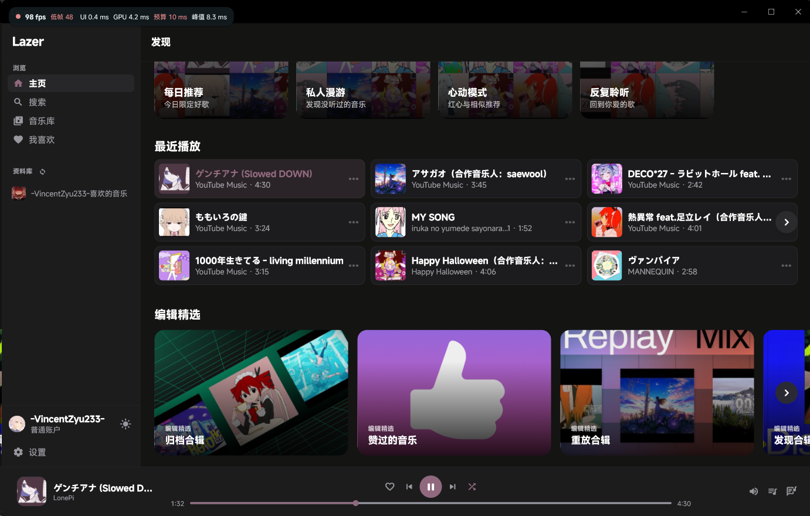
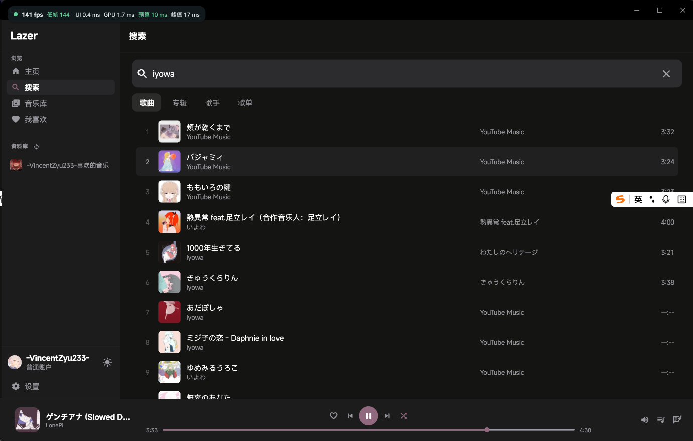
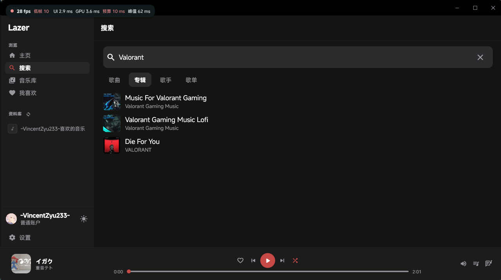
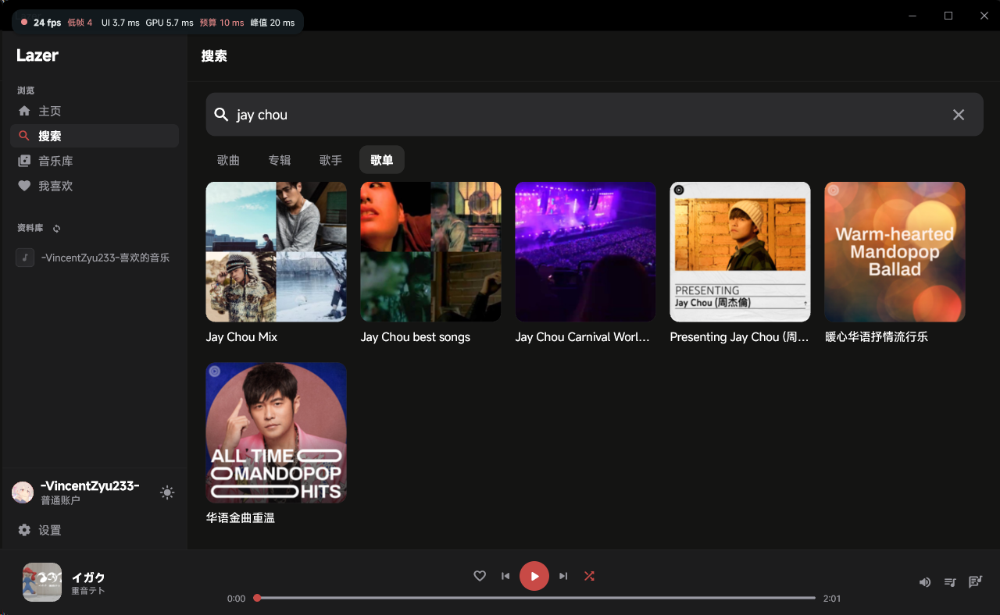
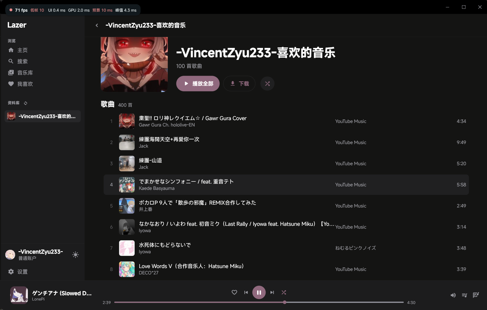

# 🎵 Lazer YouTube Music Plugin (YouTube 音乐插件)

专为 [Lazer](https://github.com/chuxuehaocai/Lazer) 现代跨平台音乐播放器打造的 **YouTube & YouTube Music 官方/第三方 Lua Gateway 扩展插件**。

---

## ✨ 特性亮点

- **精准毫秒级逐行滚动歌词（Live Lyrics）**：
  - 借鉴 [sigma67/ytmusicapi](https://github.com/sigma67/ytmusicapi) 的逆向工程精髓，采用 `ANDROID_MUSIC (7.21.50)` 移动端接口精准抓取官方毫秒级 `cueRange` 时间戳，自动合成标准同步 LRC。
  - 支持多级回退机制：无动态时间轴歌曲自动回退为 LyricFind 静态全本歌词，纯音乐（`unselectable`）秒级识别。
- **双轨全域检索**：
  - **YouTube Music**：优先呈现录音室单曲、艺人官方专辑与榜单。
  - **全量 YouTube 视频支持**：支持直接检索任意 YouTube 视频的音频轨，或在搜索栏直接粘贴视频分享链接（`youtu.be/...` 或 `watch?v=...`）秒开！
- **移动端 InnerTube 直链流提取与防缓冲卡顿（Anti-Throttling）**：
  - 参考 `yt-dlp` 逆向精髓，通过伪装移动端（Apple VisionOS / Android）客户端协议，直接提取原生 128kbps AAC / Opus 音频直链，免去复杂的网页端 JS 解密开销。
  - 智能流量调度机制，缓冲持续超越播放速率，保证播放平滑不中断。
- **双轨封面视觉融合（Dual-Track Visuals）**：
  - 完美兼顾 YouTube 官方算法定制高精合辑艺术封面（Mixart）与单曲封面池，无缝激活 Lazer 原生 30 FPS 跑马灯动态马赛克（`_MovingCoverMosaic`）拼图动效。
- **现代化分层工程架构**：
  - 深度对齐 `ytmusicapi` 原生范式，划分 `core`（通信与安全寻址 `nav()`）、`parsers`（纯数据提纯）与 `services`（业务编排调度），健壮防范空指针与 Dart 虚拟机边界异常。
- **轻量独立**：纯 Lua 实现，无额外 Python / 原生动态库依赖。

---

## 📸 界面预览 (Preview)

### 📻 1. 主页发现与专属电台 (Home Feed & Radios)
深度对接 YouTube Music 探索流与个性化推荐（今日限定好歌、私人漫游、心动模式、反复聆听），激活 30 FPS 原生封面跑马灯（`_MovingCoverMosaic`）平滑拼图动效与官方专属艺术合辑常驻。


### 🔍 2. 单曲与视频全域搜索 (Song & Video Search)
多维度精准检索官方单曲、专辑、歌手与全量 YouTube 视频，支持在搜索栏直接粘贴视频分享直链（`youtu.be/...` 或 `watch?v=...`）秒级解析播放。


### 💿 3. 专辑搜索与全盘试听 (Album Search)
支持独立专辑 Tab 检索，呈现完整的唱片发行信息与官方高品质音轨列表。


### 📑 4. 歌单与合辑特辑搜索 (Playlist Search)
检索 YouTube Music 丰富的官方精选特辑与社区公共歌单，支持一键载入整张试听。


### ❤️ 5. 红心收藏与我喜欢的音乐 (Favorites)
播放器底栏爱心一键点亮与取消，双向秒级无感同步 YouTube Music 云端“喜欢的音乐”与左侧专属资料库。


---

## 📦 安装使用指南

### 🛒 方法一：通过官方插件市场安装（推荐）

YouTube Music 插件现已正式收录于 Lazer 官方插件市场：
1. 打开 **Lazer** 播放器，进入 **设置 -> 插件管理 -> 插件市场**。
2. 在市场中找到或搜索 **“YouTube Music”** (`lazer.youtube`)。
3. 点击 **安装** 即可完成自动下载与激活，支持后续版本无感自动热更新！
4. 在播放器音源切换列表选择 **YouTube Music** 即可尽情聆听。

### 📥 方法二：通过 ZIP 本地导入

1. 前往本仓库的 [Releases](../../releases) 页面，下载最新的 `lazer.youtube.zip`。
2. 打开 **Lazer** 播放器，进入 **设置 -> 插件管理**。
3. 点击 **导入 ZIP 插件**，选择下载好的 `lazer.youtube.zip`。
4. 启用插件后，在播放器音源切换列表即可选择 **YouTube Music**！

---

## 🛠️ 本地构建与打包

项目内置了 Node.js 一键校验与打包脚本：

```bash
# 校验清单并打包为 dist/lazer.youtube.zip，同时输出 SHA-256 和 plugins.json 片段
node tools/build.js
```

---

## 💖 鸣谢与致敬

- [chuxuehaocai/Lazer](https://github.com/chuxuehaocai/Lazer) - 优雅而纯粹的手工打造跨平台音乐播放器。
- [sigma67/ytmusicapi](https://github.com/sigma67/ytmusicapi) - 优秀的 YouTube Music Python API 库（MIT），为本项目的时间戳歌词逆向、安全深度寻址工具与架构分层设计提供了核心灵感。
- [yt-dlp/yt-dlp](https://github.com/yt-dlp/yt-dlp) - 业界领先的音视频提取框架与逆向工程参考（Unlicense）。

---

## 📄 许可证

本项目遵循 [MIT](./LICENSE) 协议开源。仅供技术学习与交流使用，音视频版权归 YouTube、Google LLC 及相关版权方所有。
