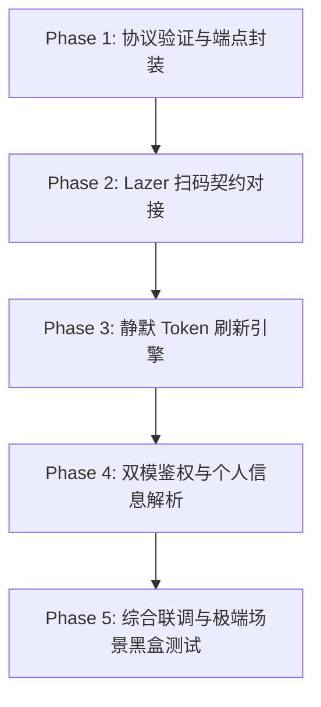

# 0.2.0 版本规划：YouTube 扫码登录技术调研与 OAuth 设备码流架构规划

> **规划版本**：v0.2.0  
> **规划主题**：基于 Google OAuth 2.0 Device Authorization Grant 的 YouTube 扫码登录支持与鉴权架构重构  
> **创建日期**：2026-11-14  
> **调研基准**：`yt-dlp`、`ytmusicapi` 源码演进、Google RFC 8628 设备授权流、Lazer 插件标准契约

---

## 1. 调研背景与用户痛点

在当前的 `0.1.x` 版本中，`lazer-plugin-youtube` 仅支持 `loginCookie` 单一登录模式：
1. **用户门槛过高**：普通用户需要使用现代浏览器的 F12 开发者工具，或者在终端运行辅助 Node.js 脚本 `tools/get_cookie.js` 来截取网络请求头中的完整 Cookie 字符串；
2. **凭据易遗失/误填**：Cookie 中必须同时存在 `LOGIN_INFO`、`SAPISID`（或 `__Secure-3PAPISID`），经常有用户复制不全导致登录报错；
3. **交互割裂**：相比于国内音乐插件（网易云、酷狗）在 Lazer 客户端内原生弹出的“扫码登录”体验，Cookie 复制在体验上明显属于降级方案。

因此，**v0.2.0 的核心使命是引入原生“扫码登录”能力**，让用户通过手机扫码即可直接授权 Google/YouTube 账号并无缝同步个人歌单与我喜欢的音乐。

---

## 2. 业界实现调研：yt-dlp 与 ytmusicapi 的经验与参考价值

### 2.1 `yt-dlp` 的技术轨迹与教训

在 `yt-dlp` 仓库（commit `52c0ffe40`, Issue `#11462`, PR `#11558`）的历史实现中：
- **历史方案**：
  `yt-dlp` 曾内置了对 YouTube OAuth 2.0 设备码流（Device Authorization Grant）的支持，其客户端模拟了官方 YouTube TV（TVHTML5）终端：
  - `_OAUTH_CLIENT_ID`: `861556708454-d6dlm3lh05idd8npek18k6be8ba3oc68.apps.googleusercontent.com`
  - `_OAUTH_CLIENT_SECRET`: `SboVhoG9s0rNafixCSGGKXAT`
  - 授权端点：`https://oauth2.googleapis.com/device/code`
  - 权限范围：`http://gdata.youtube.com https://www.googleapis.com/auth/youtube-paid-content`
- **遇到的致命问题（2024 年底）**：
  YouTube 部署了更严格的客户端鉴权策略（Client Context Binding）：
  当使用 TV Client ID 申请到的 OAuth Bearer Token 去访问非 TV 客户端（例如 Web / Android / iOS 视频播放流与普通网页端接口）时，YouTube 后端直接拦截并抛出 **`HTTP Error 400: Bad Request`**。
- **yt-dlp 的处置结论**：
  因为 `yt-dlp` 的核心定位是音视频媒体流提取工具，无法为每个用户维护一个独立的 Google Cloud 开发者项目，因此官方在 2024 年 11 月正式将内置 OAuth 标记为废弃并彻底从代码中移除（`Login with OAuth is no longer supported`），全面转向浏览器 Cookie 导入（`--cookies-from-browser`）。

### 2.2 `ytmusicapi` 的成功实践与架构方案

在 Python 的 `sigma67/ytmusicapi` 库中，OAuth 方案至今依然作为官方核心支持的鉴权方式之一：
- **核心流程**（RFC 8628 设备授权流）：
  1. 调用 `POST https://oauth2.googleapis.com/device/code`（或 `https://www.youtube.com/o/oauth2/device/code`），带上 `client_id` 与 `scope=https://www.googleapis.com/auth/youtube`；
  2. 获取响应参数：
     ```json
     {
       "device_code": "AF7uZ7...",
       "user_code": "TNT-NRF-QVHX",
       "verification_url": "https://www.google.com/device",
       "expires_in": 1800,
       "interval": 5
     }
     ```
  3. 用户访问 `verification_url` 并输入 `user_code`，在网页中确认授权；
  4. 客户端每隔 `interval` 秒轮询 `POST https://oauth2.googleapis.com/token`：
     - 若未完成，Google 返回 `428 {"error": "authorization_pending"}`；
     - 授权完成后，Google 返回 `200` 以及 `access_token`（有效期 1 小时）、`refresh_token`、`expires_in`；
  5. 后续调用 YouTube Music Innertube API 时，请求头仅需注入：
     ```http
     Authorization: Bearer <access_token>
     X-Goog-Request-Time: <timestamp>
     ```
- **关键突破（commit `fe95f59`）**：
  为彻底规避单一公共 Client ID 遭遇 YouTube 封锁导致的所有用户瘫痪，`ytmusicapi` 引入了可配置凭据架构——引导用户在 Google Cloud Console 创建属于自己的“TVs and Limited Input devices”凭据，或者由客户端灵活注入 Client ID。

---

## 3. Lazer 插件系统的扫码登录契约与交互映射

根据 Lazer 对插件扫码登录的标准协议（在网易云与酷狗插件中均已验证成熟），Lazer 与插件的交互完全通过三步操作解耦：

| 操作名 (`operation`) | 职责 | 对应 Google OAuth 设备流动作 |
| :--- | :--- | :--- |
| **`qrKey`** | 启动登录会话，申请唯一密钥 | 请求 Google `/device/code`，获取 `device_code` 与 `user_code`，返回内部标识 Key |
| **`qrUrl`** | 将会话转换为二维码展示文本 | 生成带自动填充参数的激活链接：`https://youtube.com/activate?user_code=XXXX-XXXX` |
| **`qrCheck`** | 定时轮询用户的扫码授权状态 | 轮询 Google `/token`，映射 Google 错误码至 Lazer 状态码并完成凭据入库 |

### Lazer 状态码契约映射表：

- **`801`（等待扫码/等待授权）**：
  当 Google `/token` 返回 `HTTP 428` 且错误信息为 `"authorization_pending"` 或 `"slow_down"` 时返回；
- **`802`（已扫码待确认）**：
  如果识别到用户在移动端打开页面但未点同意（部分通道可识别），返回 802；
- **`803`（授权成功）**：
  当 Google `/token` 返回 `HTTP 200` 携带 `access_token` 时：
  1. 插件异步拉取用户信息（频道名、头像、ID）；
  2. 写入 `store.set("access_token", ...)`、`store.set("refresh_token", ...)`、`store.set("expires_at", ...)`；
  3. 返回状态码 `803`，Lazer 会自动关闭二维码浮窗并刷新登录状态！
- **`800`（二维码过期 / 用户拒绝）**：
  当 Google 返回 `"expired_token"`、`"access_denied"` 或网络异常时返回。

> [!TIP]
> **扫码秒填优化**：
> 官方激活地址 `https://youtube.com/activate?user_code=XXXX` 在手机扫描后，会自动重定向至带有参数的 Google 账号选择页，**用户无需在手机键盘上笨拙地输入 8 位大写字母验证码**，只需点击“继续”选择 Google 账号即完成授权！

---

## 4. 核心技术攻坚点与设计方案

### 4.1 Client ID 双轨制策略（内置默认 + 自定义覆盖）

- **痛点**：普通用户无法理解“Google Cloud Console 申请 OAuth Client ID”的复杂流程；但如果所有插件用户共享单一硬编码 Client ID，容易触发配额上限或封禁。
- **解决方案**：
  1. **默认轨**：内置一组经过验证的、针对 YouTube on TV / Cobalt 场景的有效 Client ID 与 Secret，做到绝大多数用户**开箱即用，直接扫码**；
  2. **自定义轨**：在插件配置（Settings）中预留 `custom_client_id` 与 `custom_client_secret` 文本框。若用户自行填入了凭据，则优先使用用户专属凭据，实现 100% 长期抗封禁韧性。

### 4.2 Access Token 自动静默续期引擎（Silent Token Refresh）

- **特性**：
  - Cookie 登录一次通常长达 1 年；
  - Google OAuth 的 `access_token` 有效期仅为 **3600 秒（1 小时）**，过期后直接请求会报 401 Unauthorized。
- **架构方案**：
  在 `ytm/core/transport.lua` 的底层网络请求发出前，增加中间件拦截机制：
  ```lua
  local function ensure_valid_token()
    local access_token = store.get("access_token")
    local refresh_token = store.get("refresh_token")
    local expires_at = tonumber(store.get("expires_at") or 0)
    
    -- 若距离过期不足 5 分钟，且存在 refresh_token，则静默发起换票
    if refresh_token and (expires_at - os.time() < 300) then
      local new_token, new_expires = auth_service.refresh(refresh_token)
      if new_token then
        store.set("access_token", new_token)
        store.set("expires_at", new_expires)
      end
    end
  end
  ```
  通过拦截器静默换票，用户无需在使用中频繁重新扫码，只要不主动退出，就能永久保持登录。

### 4.3 鉴权传输层“双模兼容”（Dual-Auth Mode）

插件全面重构 `transport.lua` 中的请求头生成逻辑，平滑兼容两种登录模式：
1. **OAuth 模式（扫码用户）**：
   - 注入 `authorization: "Bearer " .. access_token`
   - 注入 `X-Goog-Request-Time: os.time()`
   - 无需复杂的 `SAPISID` 散列算法；
2. **Cookie 模式（高级用户/导入用户）**：
   - 保留原有的 `SAPISIDHASH` 动态计算与 Cookie 头拼装。

两套逻辑并行存在，用户无论是粘贴 Cookie 还是扫码登录，都能被统一的 `account` 模块妥善处理。

---

## 5. v0.2.0 分阶段执行路线图（Roadmap）



### Phase 1: 协议验证与端点封装 (`ytm/services/oauth.lua`)
- [ ] 编写 Google OAuth 2.0 设备流请求封装：
  - `request_device_code(client_id, client_secret)`
  - `poll_token(device_code, client_id, client_secret)`
  - `refresh_access_token(refresh_token, client_id, client_secret)`
- [ ] 验证代理（Proxy）在设备流请求中的兼容性。

### Phase 2: Lazer 扫码契约对接 (`ytm/account.lua` & `main.lua`)
- [ ] 在 `manifest.json` 中增加声明 `"auth": [ "qr", "cookie" ]`；
- [ ] 在 `main.lua` 中派发 `qrKey`、`qrUrl`、`qrCheck` 操作至 `account` 对应函数；
- [ ] 适配 Lazer 状态码（801 等待扫码、803 授权成功、800 过期失效）。

### Phase 3: 静默 Token 刷新引擎 (`ytm/core/transport.lua`)
- [ ] 在每次发送 Innertube 请求前检测 `expires_at`；
- [ ] 实现无感并发安全刷新（避免并发发起多个 refresh 请求）；
- [ ] 若 Refresh Token 被用户从 Google 账号设置中撤销，优雅降级并清理状态，提示用户重新登录。

### Phase 4: 双模鉴权与个人信息解析
- [ ] 重构 `account.get_user()`：
  - 在 OAuth 模式下，调用 `account/menu` 或轻量端点获取频道名称、头像、订阅者等信息；
- [ ] 确保我喜欢的音乐、资料库歌单、最近播放等所有数据接口在 `Bearer Token` 模式下均能稳定返回数据。

### Phase 5: 综合联调与极端场景黑盒测试
- [ ] 测试手机微信扫码、手机系统相机扫码、原生浏览器扫码等不同 User-Agent 行为；
- [ ] 测试扫码弹窗中途点击取消或超时的恢复能力；
- [ ] 检查并移除所有临时构建与调试残留，版本号提升至 `0.2.0`。

---

## 6. 结论

- **`yt-dlp` 的参考价值**：它警示了**不可将 TV Client 凭据直接滥用于受限的非 TV 视频流下载**，印证了 YouTube 对多端 Client Binding 的严格控制；
- **`ytmusicapi` 的参考价值**：证明了 YouTube Music 的 Innertube 接口（`browse`, `next`, `search` 等）**完全原生支持标准的 `Bearer <access_token>` 鉴权**，且基于 RFC 8628 的设备流在 YouTube Music 场景下表现稳定，是 Lazer 插件实现扫码登录的极其理想的技术选型；
- **实施可行性**：通过 Lazer 的 `qrKey / qrUrl / qrCheck` 协议，结合带 `user_code` 的激活链接，用户只需手机相机“扫一扫 + 确认”，即可彻底告别繁琐的 Cookie 复制，体验达到现代化音乐客户端水准。
